<picture><source media="(prefers-color-scheme: dark)" srcset="./assets/dark/hero.svg"></picture>

<a href="https://codeshare.me"><picture><source media="(prefers-color-scheme: dark)" srcset="./assets/dark/links/codeshare.svg"></picture></a>
<a href="https://umutbayraktar.vercel.app"><picture><source media="(prefers-color-scheme: dark)" srcset="./assets/dark/links/portfolio.svg"></picture></a>
<a href="https://linkedin.com/in/umutxyp"><picture><source media="(prefers-color-scheme: dark)" srcset="./assets/dark/links/linkedin.svg"></picture></a>
<a href="https://youtube.com/@umutxyp"><picture><source media="(prefers-color-scheme: dark)" srcset="./assets/dark/links/youtube.svg"></picture></a>
<a href="https://instagram.com/umutxyp"><picture><source media="(prefers-color-scheme: dark)" srcset="./assets/dark/links/instagram.svg"></picture></a>
<a href="https://tiktok.com/@umutxyp"><picture><source media="(prefers-color-scheme: dark)" srcset="./assets/dark/links/tiktok.svg"></picture></a>
<a href="https://t.me/umutxyp"><picture><source media="(prefers-color-scheme: dark)" srcset="./assets/dark/links/telegram.svg"></picture></a>
<a href="https://twitter.com/devbayraktar"><picture><source media="(prefers-color-scheme: dark)" srcset="./assets/dark/links/x.svg"></picture></a>
<a href="https://facebook.com/umutxyp"><picture><source media="(prefers-color-scheme: dark)" srcset="./assets/dark/links/facebook.svg"></picture></a>
<a href="mailto:umutbayraktar55@gmail.com"><picture><source media="(prefers-color-scheme: dark)" srcset="./assets/dark/links/email.svg"></picture></a>

<picture><source media="(prefers-color-scheme: dark)" srcset="./assets/dark/headings/about.svg"></picture>

<picture><source media="(prefers-color-scheme: dark)" srcset="./assets/dark/about.svg"></picture>

<picture><source media="(prefers-color-scheme: dark)" srcset="./assets/dark/stats.svg"></picture>

<picture><source media="(prefers-color-scheme: dark)" srcset="./assets/dark/headings/projects.svg"></picture>

<a href="https://codeshare.me"><picture><source media="(prefers-color-scheme: dark)" srcset="./assets/dark/studio.svg"></picture></a>

<a href="https://beatra.app"><picture><source media="(prefers-color-scheme: dark)" srcset="./assets/dark/projects/beatra.svg"></picture></a>
<a href="https://github.com/umutxyp/Shroudly"><picture><source media="(prefers-color-scheme: dark)" srcset="./assets/dark/projects/shroudly.svg"></picture></a>
<a href="https://vanigo.app"><picture><source media="(prefers-color-scheme: dark)" srcset="./assets/dark/projects/vanigo.svg"></picture></a>
<a href="https://sylon.app"><picture><source media="(prefers-color-scheme: dark)" srcset="./assets/dark/projects/sylon.svg"></picture></a>
<a href="https://mcstat.org"><picture><source media="(prefers-color-scheme: dark)" srcset="./assets/dark/projects/mcstat.svg"></picture></a>
<a href="https://justanime.me"><picture><source media="(prefers-color-scheme: dark)" srcset="./assets/dark/projects/justanime.svg"></picture></a>
<a href="https://justdiscord.org"><picture><source media="(prefers-color-scheme: dark)" srcset="./assets/dark/projects/justdiscord.svg"></picture></a>
<a href="https://dotrai.com"><picture><source media="(prefers-color-scheme: dark)" srcset="./assets/dark/projects/dotrai.svg"></picture></a>

<picture><source media="(prefers-color-scheme: dark)" srcset="./assets/dark/headings/stack.svg"></picture>

<picture><source media="(prefers-color-scheme: dark)" srcset="./assets/dark/stack.svg"></picture>

<picture><source media="(prefers-color-scheme: dark)" srcset="./assets/dark/headings/opensource.svg"></picture>

<a href="https://github.com/umutxyp/MusicBot"><picture><source media="(prefers-color-scheme: dark)" srcset="./assets/dark/opensource/musicbot.svg"></picture></a>
<a href="https://github.com/umutxyp/Seo-Promt-Master"><picture><source media="(prefers-color-scheme: dark)" srcset="./assets/dark/opensource/seo-promt-master.svg"></picture></a>
<a href="https://github.com/umutxyp/Discord-Bot-Website"><picture><source media="(prefers-color-scheme: dark)" srcset="./assets/dark/opensource/discord-bot-website.svg"></picture></a>
<a href="https://github.com/umutxyp/Personal-Website"><picture><source media="(prefers-color-scheme: dark)" srcset="./assets/dark/opensource/personal-website.svg"></picture></a>
<a href="https://github.com/umutxyp/Shroudly"><picture><source media="(prefers-color-scheme: dark)" srcset="./assets/dark/opensource/shroudly.svg"></picture></a>
<a href="https://github.com/umutxyp/v14-discord-bot"><picture><source media="(prefers-color-scheme: dark)" srcset="./assets/dark/opensource/v14-discord-bot.svg"></picture></a>
